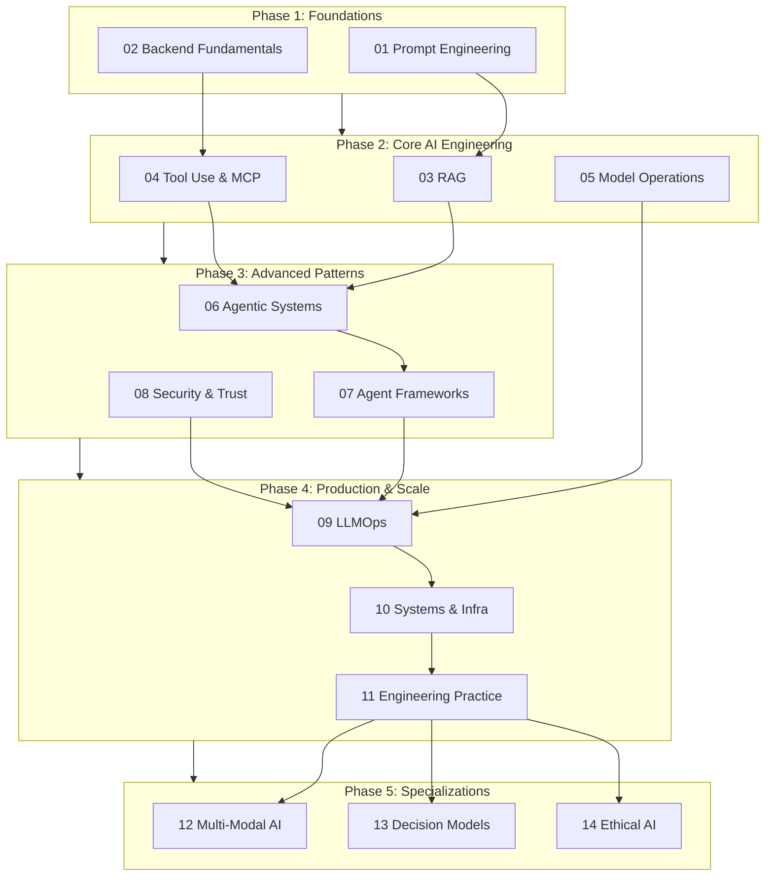

<p align="center">
  <h1 align="center">AI Engineer Study Guide</h1>
  <p align="center">
    A structured, self-directed curriculum for becoming a production-grade AI engineer.<br>
    From prompt engineering to agentic systems to ethical deployment — everything you need, nothing you don't.
  </p>
</p>

<p align="center">
  
  
  
  
  
</p>

<p align="center">
  <a href="./study-app/index.html"><strong>Interactive Study App</strong></a> ·
  <a href="#visual-roadmap"><strong>Visual Roadmap</strong></a> ·
  <a href="#quick-start"><strong>Start Learning</strong></a> ·
  <a href="./CONTRIBUTING.md"><strong>Contributing</strong></a>
</p>

---

> **92% of developers now use AI coding tools** (GitHub, 2026). The tooling is everywhere. What separates a developer who *uses* AI from an engineer who *builds with* AI is depth — retrieval architecture, agent design, model operations, production trust. This guide covers that depth.

---

## Why This Exists

This is **not** an awesome-list. There are no 400 links to skim and forget.

This is **not** an online course. There are no video lectures or paywalls.

This is **not** theory-only. Every module connects to production decisions real teams face.

This is a **study guide** — opinionated, structured, and deep. It covers the 14 modules an AI engineer needs to own, organized into a clear progression from fundamentals to specializations. Each topic includes written notes designed to be understood well enough to explain under pressure.

---

## Who This Is For

| Background | Recommended Entry Point | Focus Areas |
|---|---|---|
| **Software engineer adding AI skills** | Phase 1 -- start from the beginning | Prompt engineering, RAG, tool use |
| **ML engineer moving to applied AI** | Phase 2 -- core AI engineering | Agent design, MCP, model operations |
| **Backend engineer building AI features** | Phase 1, Module 02 -- backend fundamentals | Systems integration, LLMOps, infra |
| **Tech lead / architect** | Phase 3 -- advanced patterns | Security, agentic coordination, trust |
| **Career switcher** | Phase 1, Module 01 -- prompt engineering | Full curriculum, linear progression |

---

## Visual Roadmap



---

## Curriculum

### Phase 1: Foundations (~2 weeks)

| # | Module | Topics | Est. Time | Status |
|---|--------|--------|-----------|--------|
| 01 | [Prompt Engineering](./modules/01-prompt-engineering/) | 5 | ~8h | [ ] Coming soon |
| 02 | [Backend Fundamentals](./modules/02-backend-fundamentals/) | 4 | ~6h | [ ] Coming soon |

### Phase 2: Core AI Engineering (~4 weeks)

| # | Module | Topics | Est. Time | Status |
|---|--------|--------|-----------|--------|
| 03 | [RAG](./modules/03-rag/) | 6 | ~12h | [x] Notes complete |
| 04 | [Tool Use & MCP](./modules/04-tool-use-mcp/) | 4 | ~8h | [ ] Coming soon |
| 05 | [Model Operations](./modules/05-model-operations/) | 5 | ~10h | [ ] Coming soon |

### Phase 3: Advanced Patterns (~3 weeks)

| # | Module | Topics | Est. Time | Status |
|---|--------|--------|-----------|--------|
| 06 | [Agentic Systems](./modules/06-agentic-systems/) | 6 | ~10h | [ ] Coming soon |
| 07 | [Agent Frameworks](./modules/07-agent-frameworks/) | 6 | ~8h | [ ] Coming soon |
| 08 | [Security & Trust](./modules/08-security-trust/) | 5 | ~8h | [ ] Coming soon |

### Phase 4: Production & Scale (~3 weeks)

| # | Module | Topics | Est. Time | Status |
|---|--------|--------|-----------|--------|
| 09 | [LLMOps](./modules/09-llmops/) | 6 | ~10h | [ ] Coming soon |
| 10 | [Systems & Infra](./modules/10-systems-infra/) | 5 | ~8h | [ ] Coming soon |
| 11 | [Engineering Practice](./modules/11-engineering-practice/) | 4 | ~6h | [ ] Coming soon |

### Phase 5: Specializations (~2 weeks each)

| # | Module | Topics | Est. Time | Status |
|---|--------|--------|-----------|--------|
| 12 | [Multi-Modal AI](./modules/12-multimodal-ai/) | 5 | ~8h | [ ] Coming soon |
| 13 | [Decision Models](./modules/13-decision-models/) | 5 | ~8h | [ ] Coming soon |
| 14 | [Ethical AI](./modules/14-ethical-ai/) | 5 | ~6h | [ ] Coming soon |

---

## Quick Start

```bash
# Clone the repository
git clone https://github.com/your-username/ai-engineer.git
cd ai-engineer

# Browse the syllabus
cat syllabus.md

# Open the interactive study app
open study-app/index.html
```

Start with the [syllabus](./syllabus.md) for a full topic list, or jump into the [RAG module](./modules/03-rag/) — it is the most complete section with six written topics, a cheat sheet, interview questions, and a runnable project.

---

## Project Structure

```
ai-engineer/
├── README.md                          # This file
├── ROADMAP.md                         # Visual learning path with Mermaid diagrams
├── syllabus.md                        # Master topic list (66 topics, 14 modules)
├── CONTRIBUTING.md                    # How to contribute
│
├── modules/                           # All 14 modules
│   ├── 01-prompt-engineering/         # Phase 1
│   ├── 02-backend-fundamentals/
│   ├── 03-rag/                        # Phase 2 (complete: notes + cheatsheet + interview + project)
│   ├── 04-tool-use-mcp/
│   ├── ...
│   └── 14-ethical-ai/                 # Phase 5
│
├── study-app/                         # Interactive flashcard study app
│   ├── index.html
│   ├── css/styles.css
│   └── js/
│
├── trending/                          # Fast-moving AI landscape topics
├── resources/                         # Curated books, courses, papers, tools
└── _templates/                        # Templates for contributing content
```

---

## How to Contribute

Contributions are welcome. Whether it is fixing a factual error, adding depth to an existing topic, or writing notes for a new module — all of it helps.

See [CONTRIBUTING.md](./CONTRIBUTING.md) for guidelines on structure, style, and pull request expectations.

---

## License

This project is licensed under the [MIT License](./LICENSE).

---

<p align="center">
  Built for engineers who want to understand AI deeply, not just use it superficially.
</p>
