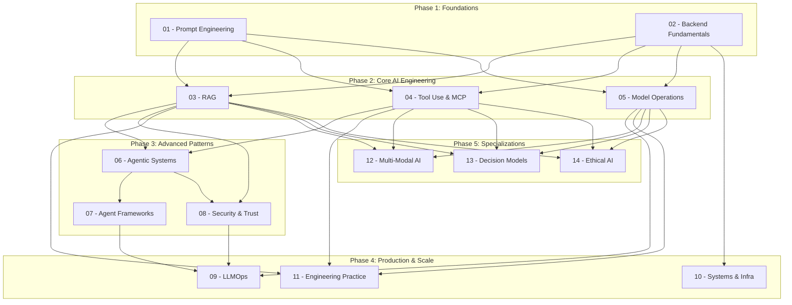

# AI Engineer Study Guide -- Learning Roadmap

This document provides a visual learning path for the AI Engineer Study Guide. The curriculum is organized into **5 phases** that build on each other progressively:

1. **Phase 1 -- Foundations:** Core skills every AI engineer needs before touching advanced topics.
2. **Phase 2 -- Core AI Engineering:** The bread and butter of day-to-day AI engineering work.
3. **Phase 3 -- Advanced Patterns:** Complex system design, agent architectures, and trust layers.
4. **Phase 4 -- Production & Scale:** Taking AI systems from prototype to production-grade infrastructure.
5. **Phase 5 -- Specializations:** Focused deep-dives into emerging and cross-cutting areas.

Each phase has explicit prerequisites. You should complete (or be confident in) all dependencies before moving forward. The diagram below shows the full prerequisite chain across all 14 modules.

---

## Full Prerequisite Map

---

## Phase-by-Phase Breakdown

### Phase 1: Foundations

| Detail | Value |
|---|---|
| **Time estimate** | 2-3 weeks |
| **What you will learn** | How to communicate effectively with LLMs through prompt design; core backend patterns that underpin every AI system. |
| **Prerequisites** | Basic programming experience; familiarity with Python or TypeScript; understanding of HTTP and REST APIs. |
| **Modules** | 01 - Prompt Engineering, 02 - Backend Fundamentals |

This phase ensures you have the two pillars required for everything that follows: the ability to control model behavior through prompts, and the backend engineering skills to build reliable services around those models.

---

### Phase 2: Core AI Engineering

| Detail | Value |
|---|---|
| **Time estimate** | 4-6 weeks |
| **What you will learn** | Retrieval-augmented generation pipelines; tool integration via MCP and function calling; model lifecycle management including fine-tuning, quantization, and serving. |
| **Prerequisites** | Phase 1 complete. |
| **Modules** | 03 - RAG, 04 - Tool Use & MCP, 05 - Model Operations |

This phase covers the core technical skills that distinguish an AI engineer from a general backend engineer. You will learn how to build retrieval systems, connect models to external tools, and manage model operations end to end.

---

### Phase 3: Advanced Patterns

| Detail | Value |
|---|---|
| **Time estimate** | 4-6 weeks |
| **What you will learn** | Autonomous agent architectures; framework evaluation and selection; security hardening, prompt injection defense, and trust engineering. |
| **Prerequisites** | Modules 03 (RAG) and 04 (Tool Use & MCP) are required for Module 06. Module 06 is required for Modules 07 and 08. Module 03 is also required for Module 08. |
| **Modules** | 06 - Agentic Systems, 07 - Agent Frameworks, 08 - Security & Trust |

This is where you move from building components to building systems. Agents introduce non-determinism, feedback loops, and security surfaces that demand careful design.

---

### Phase 4: Production & Scale

| Detail | Value |
|---|---|
| **Time estimate** | 4-5 weeks |
| **What you will learn** | Deployment pipelines and CI/CD for AI; distributed system design; production monitoring; GPU infrastructure; engineering leadership practices. |
| **Prerequisites** | Module 05 (Model Operations) and Phase 3 completion are required for Module 09. Module 02 (Backend Fundamentals) is required for Module 10. Phase 2 completion is required for Module 11. |
| **Modules** | 09 - LLMOps, 10 - Systems & Infra, 11 - Engineering Practice |

Production readiness is what separates demos from real products. This phase covers the operational, infrastructure, and organizational skills needed to ship and maintain AI systems at scale.

---

### Phase 5: Specializations

| Detail | Value |
|---|---|
| **Time estimate** | 3-5 weeks (choose your focus areas) |
| **What you will learn** | Multi-modal model integration; structured decision and reasoning models; AI ethics, regulation, and incident response. |
| **Prerequisites** | Phase 2 (Core AI Engineering) complete. These modules can be studied in any order. |
| **Modules** | 12 - Multi-Modal AI, 13 - Decision Models, 14 - Ethical AI |

These are independent specialization tracks. You do not need to complete all three -- pick the ones most relevant to your role or interests.

---

## Choose Your Path

Not everyone has the same goals. Below are three recommended paths through the curriculum depending on what you are optimizing for.

### Path A: Job Interview Prep

**Goal:** Prepare for AI engineer interviews in the shortest time possible.

**Focus modules (in order):**
1. 01 - Prompt Engineering
2. 03 - RAG
3. 06 - Agentic Systems
4. 05 - Model Operations
5. 08 - Security & Trust
6. 10 - Systems & Infra

**Time estimate:** 5-7 weeks

**Rationale:** Interviewers focus on system design, retrieval, agent reasoning, and production awareness. This path hits those areas while skipping framework-specific and specialization content that is less likely to appear in interviews.

---

### Path B: Side Project Builder

**Goal:** Build a working AI-powered application from idea to deployment.

**Focus modules (in order):**
1. 01 - Prompt Engineering
2. 02 - Backend Fundamentals
3. 03 - RAG
4. 04 - Tool Use & MCP
5. 07 - Agent Frameworks
6. 09 - LLMOps

**Time estimate:** 6-8 weeks

**Rationale:** This path prioritizes hands-on building. You will learn to design prompts, build a backend, wire up retrieval and tools, pick a framework, and deploy your project with proper observability.

---

### Path C: Career Upskilling

**Goal:** Comprehensive mastery across the full AI engineering stack.

**Focus modules (in order):**
1. All 14 modules, Phases 1 through 5

**Time estimate:** 16-24 weeks

**Rationale:** If you have the time and want to be thorough, work through every phase sequentially. This is the most complete path and will give you depth across foundations, production systems, and specializations.

---

## Role Comparison: AI Engineer vs ML Engineer vs Data Scientist

| Dimension | AI Engineer | ML Engineer | Data Scientist |
|---|---|---|---|
| **Primary focus** | Building applications powered by foundation models (LLMs, multi-modal models) | Training, optimizing, and deploying custom ML models | Analyzing data, building statistical models, generating insights |
| **Core skills** | Prompt engineering, RAG, agent design, API integration, LLMOps | Model training, feature engineering, MLOps, distributed training | Statistics, EDA, hypothesis testing, visualization, experimentation |
| **Typical models used** | Pre-trained foundation models (GPT, Claude, Llama, Gemini) | Custom-trained models (XGBoost, transformers, CNNs) | Statistical models, classical ML, sometimes deep learning |
| **Training vs inference** | Primarily inference; occasional fine-tuning | Heavy training and fine-tuning | Training for analysis; inference for reporting |
| **Infrastructure** | API gateways, vector databases, agent orchestration, model routers | GPU clusters, training pipelines, model registries, feature stores | Notebooks, data warehouses, BI tools, experiment trackers |
| **Key deliverables** | AI-powered products, chatbots, agent systems, RAG pipelines | Trained models, prediction services, ML pipelines | Dashboards, reports, A/B test analyses, data models |
| **Evaluation focus** | End-to-end system quality, latency, cost, user experience | Model accuracy, F1, AUC, training efficiency | Statistical significance, business impact, data quality |
| **Closest to** | Software engineering | Systems engineering | Research and analytics |
| **This guide covers** | Directly applicable | Partially overlapping (Modules 05, 09, 10) | Minimal overlap (Modules 13, 14) |

---

## Next Steps

Open `syllabus.md` for the full topic-level breakdown of all 14 modules, including the progress tracker.
